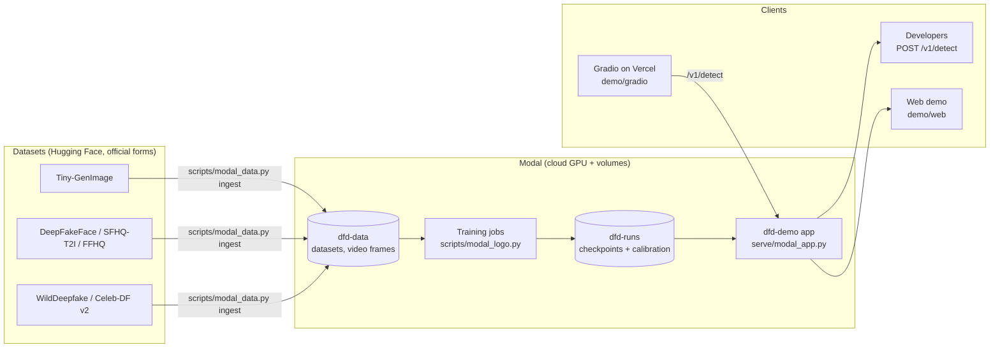
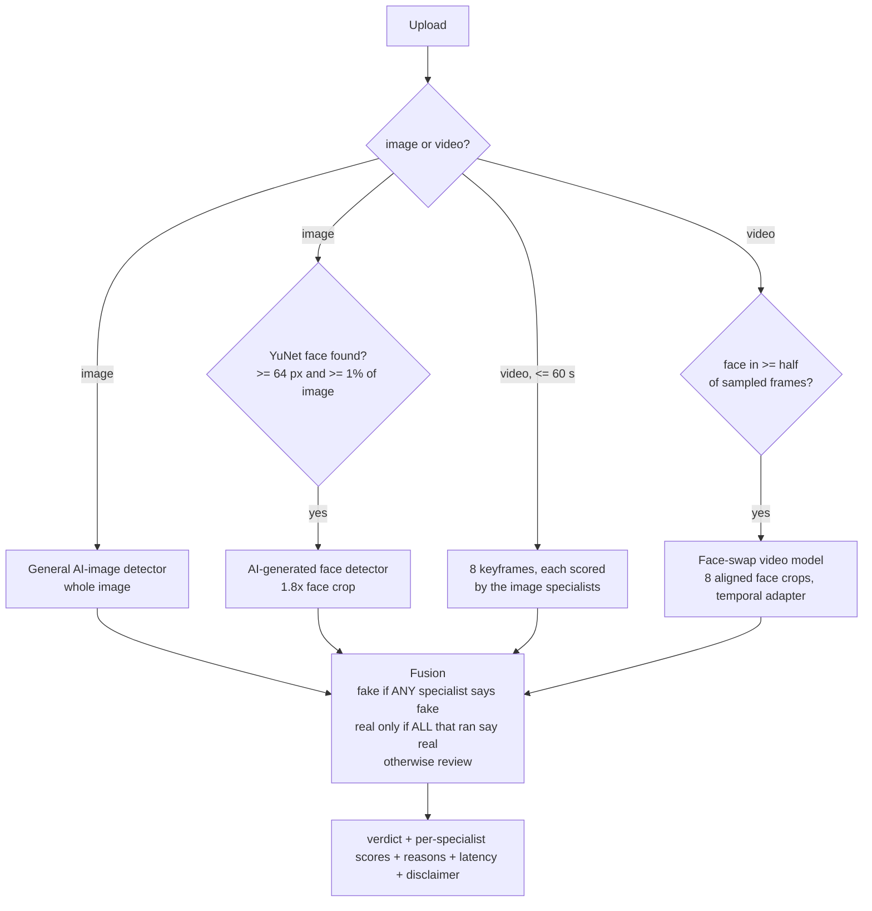

# DFD: calibrated deepfake detection for social media

DFD is a research system that flags AI-generated and manipulated images and videos the way a social platform
would need it to. It is built to generalize to generators it has never seen, to survive platform re-compression
and beauty filters, and to say **"I don't know"** instead of guessing. Every verdict is `real`, `fake` or
`review` (send to a human), with thresholds calibrated to a 1% false-alarm target.

It ships as a hosted detector API plus two demo front ends: a ChatGPT-style playground with Instagram- and
Reels-style feeds that flag posts live, and a Gradio app.

> **Research demo, not an enforcement tool.** Several training datasets are non-commercial or research-only,
> and the models have known blind spots (listed under [Limitations](#limitations)).

## Contents
- [How it works](#how-it-works)
- [Results](#results)
- [Repository map (from the knowledge graph)](#repository-map-from-the-knowledge-graph)
- [Quick start](#quick-start)
- [Using the detector](#using-the-detector)
- [Training and evaluation](#training-and-evaluation)
- [Deployment](#deployment)
- [Exploring the code with graphify](#exploring-the-code-with-graphify)
- [Limitations](#limitations)
- [Project docs and how the work is organized](#project-docs-and-how-the-work-is-organized)

## How it works

### System overview



### The detection router

One upload is scored by up to three specialists, then fused conservatively
(`src/dfd/inference/router.py`, `MultiDetector`):



An uncalibrated or abstaining specialist always counts as `review`. Without the video model, a video can be
flagged fake but never called real.

### The model

All three specialists share one design (`src/dfd/models/`):

- **Backbone:** frozen DINOv2-base with LoRA (rank 8) on the last 3 blocks. Features are the layer-normed CLS
  token plus mean patch token from layers 4, 8, 10 and 12 (`FoundationBackbone`).
- **Head:** a variational information bottleneck (latent 128) plus a linear classifier (`VIBHead`), which
  discourages memorizing generator-specific shortcuts.
- **Video:** a temporal adapter over per-frame features (`TemporalAdapter`), 8 frames per clip.
- **Training augmentation:** platform transcoding emulation (`PlatformTranscodingEmulator`) re-encodes every
  sample with random resize, JPEG/WebP compression, blur, noise, colour jitter and beauty-filter simulation,
  so the detector survives what social platforms do to uploads.
- **Calibration:** temperature scaling plus split-conformal thresholds, fit only on a held-out calibration
  split (`src/dfd/eval/calibration.py`). Scores above `tau_fake` are `fake`, below `tau_real` are `real`, and
  everything between abstains. A missing or mismatched calibration file forces abstention.
- **Evaluation protocol:** nested leave-one-generator-out. The test generator is never trained on, a separate
  generator picks the checkpoint, and calibration uses only the fit split (`docs/implementation-architecture.md` §7).

## Results

Measured on held-out data; "single run" means one training run without a confidence interval. Full tables
are in `docs/implementation-architecture.md` §11.

| Specialist | Key result | Weakness |
|---|---|---|
| **General AI-image** (Tiny-GenImage) | Unseen generators, 7 rotations: mean AUC **0.915**, TPR@1%FPR 0.42; conformal FPR ~1.2%, abstain ~45% | Midjourney AUC 0.741 |
| **AI-generated faces** (B3) | Held-out Flux AUC **0.988**; Flux variants caught 86–93%; FairFace real-face FPR **0.58%**, no race group significantly above 1% | Not a face-swap detector (WildDeepfake frames at chance) |
| **Face-swap video** (V3) | WildDeepfake test AUC **0.877**, real clips called fake 0.5%; Celeb-DF v2 test AUC **0.845**, real called fake 1.1% (single run) | Talking-head animation: AUC 0.44, 41% of those fakes score real; 75–83% of clips go to review |

Negative results are kept on purpose: video V1 overfit a dataset pair (53.5% of real in-the-wild clips called
fake), out-of-distribution gating did not help, and a pre-registered attention-pooling ablation was flat
(mean ΔAUC −0.0002, 95% CI [−0.0028, +0.0023]).

Warm latency on the deployed L4: about 70 ms server time per image and about 0.6 s per video. The first request
after idle takes about 24 s (GPU cold start).

## Repository map (from the knowledge graph)

A [graphify](#exploring-the-code-with-graphify) extraction of the repo (2,158 nodes, 4,307 edges, 133
communities; refreshed 2026-10-25) gives this layout. Its most connected abstractions, the "god nodes", are
`DeepfakeDetector`, `build_base_datasets()`, `DetectorTransform`, `PTEConfig`, `DetectionPipeline`, `Config`,
`TransformedDataset` and `Calibration`.

| Path | What lives there | Key nodes |
|---|---|---|
| `src/dfd/models/` | Backbone, LoRA, VIB head, temporal adapter | `DeepfakeDetector`, `FoundationBackbone`, `VIBHead`, `TemporalAdapter` |
| `src/dfd/data/` | Datasets, platform transcoding emulation, video frame extraction | `build_base_datasets()`, `PlatformTranscodingEmulator`, `DetectorTransform`, `TransformedDataset`, `VideoClipDataset` |
| `src/dfd/training/` | Training loop, losses, beta schedule | `Trainer`, `predict()` |
| `src/dfd/eval/` | Metrics, conformal calibration, fairness, OOD experiment | `Calibration`, `calibrate()`, `paired_bootstrap()` |
| `src/dfd/inference/` | Calibrated pipeline and the multi-specialist router | `DetectionPipeline`, `MultiDetector`, `FaceDetector`, `VideoClipScorer` |
| `src/dfd/tinker_route/` | VLM second-opinion route on Tinker (experimental) | `VLMScorer` |
| `serve/` | Modal app `dfd-demo`: GPU detector, API and web ASGI apps | `Detector`, `build_api()`, `build_web()` |
| `scripts/` | CLIs: train, evaluate, predict, Modal launchers, data ingest, demo seeding | `train.py`, `modal_logo.py`, `modal_data.py`, `demo_seed.py` |
| `configs/` | YAML experiment configs (smoke, image LOGO, faces, video V1–V3) | `smoke.yaml`, `tiny_genimage_all.yaml`, `video_wdf_v3.yaml` |
| `demo/web/` | Vite + React demo: playground, Spectra Guard feed, Reels, developer page | `Playground`, `Instagram`, `Reels`, `ExplanationSheet` |
| `demo/gradio/` | Gradio front end for Vercel (calls `/v1/detect`, mock mode without a backend) | `app.py`, `backend.py` |
| `tests/` | pytest suite (models, data, video, router, upload limits, fairness, ...) | `test_router.py`, `test_video_v2.py` |
| `docs/`, `research/` | Architecture spec and build log; literature and dataset research | `implementation-architecture.md` |

## Quick start

Requires Python 3.12 and [uv](https://docs.astral.sh/uv/).

```bash
uv venv --python 3.12 .venv
uv pip sync --python .venv/bin/python requirements.lock
uv pip install --python .venv/bin/python --no-deps -e .

.venv/bin/pytest -q                                          # test suite (~10 s)
.venv/bin/python scripts/train.py --config configs/smoke.yaml  # synthetic end-to-end run (~1 min)
```

Secrets (`HF_TOKEN`, `TINKER_API_KEY`, `DFD_API_KEY`, ...) come from the environment or a git-ignored `.env`,
loaded by `dfd.env.load_dotenv()`. Never commit them.

## Using the detector

### Hosted API

The Modal app exposes:

| Endpoint | Auth | Purpose |
|---|---|---|
| `GET /v1/health` | none | liveness |
| `GET /v1/models` | Bearer key | the specialists, their checkpoints, metrics and limitations |
| `POST /v1/detect` | Bearer key | multipart `file`: JPG/PNG/WebP up to 15 MB, MP4/MOV/WebM up to 50 MB and 60 s |

```bash
curl -H "Authorization: Bearer $DFD_API_KEY" -F file=@photo.jpg \
     https://<workspace>--dfd-demo-api.<region>.modal.run/v1/detect
```

The response includes `verdict` (`real` / `fake` / `review`), `label`, `confidence`, `specialists` (each with
`p_fake`, verdict and calibration status), `faces`, `video` (keyframes and method), `reasons`, `latency_ms`,
`model_versions` and a disclaimer.

### Python

```python
from PIL import Image
from dfd.inference.pipeline import DetectionPipeline

pipe = DetectionPipeline("runs/<run>/best.pt", None, "auto", crop_mode="center")  # reads calibration.json beside it
res = pipe.score_pil(Image.open("photo.jpg").convert("RGB"))
print(res.verdict, res.p_fake)   # "fake" | "real" | "abstain"
```

For files from the command line: `.venv/bin/python scripts/predict.py --checkpoint runs/<run>/best.pt img.jpg clip.mp4`.

The served checkpoints (general, face, video) with calibration files and a model card are in a private Hugging
Face repo, `thesteven123/dfd-detector`, under CC-BY-NC-SA 4.0.

## Training and evaluation

GPU work runs on [Modal](https://modal.com) (L4, about $1.43 per GPU-hour list price). Launch anything longer
than a few minutes with `--detach`.

```bash
# Data: plan sizes, then ingest into the dfd-data volume
.venv/bin/modal run scripts/modal_data.py --action plan
.venv/bin/modal run --detach scripts/modal_data.py --action ingest --dataset wilddeepfake_train
.venv/bin/modal run --detach scripts/modal_data.py --action frames          # video frame extraction

# Image detector: nested leave-one-generator-out, all 7 rotations in parallel
.venv/bin/modal run --detach scripts/modal_logo.py --rotations all --base-config configs/tiny_genimage_nested_full.yaml

# Any single config (e.g. the served video model)
.venv/bin/modal run --detach scripts/modal_logo.py --rotations config --base-config configs/video_wdf_v3.yaml --epochs 4 --tag video_v3

# External real-world evaluation with the checkpoint's own calibration
.venv/bin/modal run --detach scripts/modal_data.py --action eval --dataset all --checkpoint /runs/<tag>/<rotation>/best.pt

# Locally: severity sweep, paired centre/multi-crop comparison
.venv/bin/python scripts/evaluate.py --checkpoint runs/<run>/best.pt --config <cfg> --split test --crop-mode both --save-preds
```

Each run writes `best.pt`, `calibration.json`, `config.yaml`, `report.json` and `report.md` to the `dfd-runs`
volume, with local copies under `runs/modal/<tag>/`.

## Deployment

```bash
# Build the web demo (bundled into the Modal image)
(cd demo/web && npm ci && npm run build)

# Deploy the API, the web app and the GPU detector (scale-to-zero L4)
.venv/bin/modal deploy serve/modal_app.py

# Rebuild the sample feeds from held-out data (writes the dfd-demo volume)
.venv/bin/modal run --detach serve/modal_app.py --action seed
```

Modal secrets: `dfd-api` (`DFD_API_KEY`, for the API) and `dfd-demo` (`DEMO_PASSCODE`, for the web app's signed
HttpOnly session cookie). For live demos, set `min_containers=1` on `Detector` in `serve/modal_app.py` to avoid
the cold start.

- **Web demo dev:** `cd demo/web && npm install && VITE_MOCK=1 npm run dev` (mock mode, no backend). See `demo/web/README.md`.
- **Gradio on Vercel:** root directory `demo/gradio`, with env `DFD_API_URL` (the API base URL, no `/v1/detect`)
  and `DFD_API_KEY`. Vercel caps request bodies at about 4.5 MB. See `demo/gradio/README.md`.

## Exploring the code with graphify

The repo map above comes from a graphify knowledge graph of the code,
configs and docs. To refresh and query it:

```bash
graphify update .                                   # re-extract code (no LLM needed), then re-cluster
graphify query "How does an upload become a calibrated verdict?"
graphify path "MultiDetector" "DeepfakeDetector"   # -> MultiDetector uses DetectionPipeline uses DeepfakeDetector
graphify explain "VideoClipScorer"                  # neighbours: DeepfakeDetector, DetectorTransform, Calibration, ...
```

Output goes to `graphify-out/`: `GRAPH_REPORT.md` (god nodes, communities, surprising links), `graph.json`, and
an interactive `graph.html`.

## Limitations

- **Talking-head / audio-driven animation and modern text-to-video are not covered.** The video model is a
  face-swap detector.
- **Face swaps in still images are not detected** by any specialist.
- **High review load:** 42–83% of inputs abstain at the 1% false-alarm target.
- **In-the-wild real faces** can exceed the 1% target (2.4% for the face model on WildDeepfake real faces).
- Most face and video results are single runs; only the image protocol has spread across rotations.
- Content credentials (C2PA) are only checked for presence, not cryptographically verified.
- No per-client keys, rate limiting or production monitoring yet.
- **Licensing:** Tiny-GenImage and FFHQ are CC-BY-NC-SA, Celeb-DF is non-commercial research only, and
  IMDB-WIKI (inside DeepFakeFace) is research-only. A commercial model would need different training data.

## Project docs and how the work is organized

| Document | Purpose |
|---|---|
| `docs/implementation-architecture.md` | Source of truth for the design; §11 is the dated build log with every result |
| `docs/architecture-spec.md`, `docs/model-plan.md` | Original architecture specification and model plan |
| `research/` | Literature review, dataset surveys, fairness notes, adversarial critique |
| `CODE_REVIEW.md` | Code-review findings and responses |
| `AGENTS.md`, `agent_roles/` | Agent roles: implementation, research, code review, git organization |

All git operations (branches, commits, PRs, merges) go through the git-organizer agent; see `AGENTS.md`.
