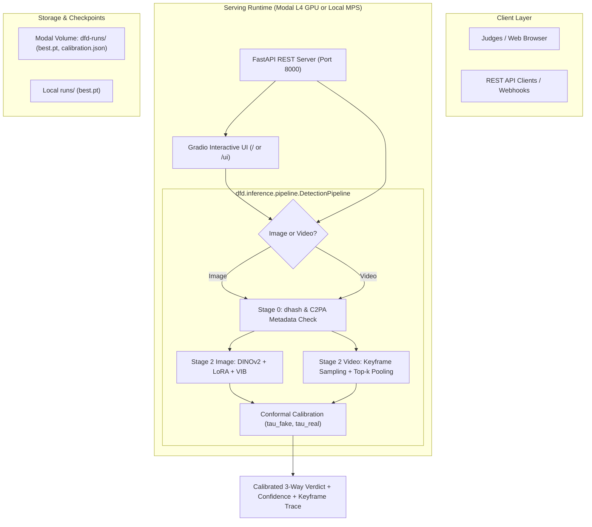

# Hackathon Deployment & Interactive Showcase Architecture

> **Superseded.** The deployed demo is now served by `serve/` (Modal app `dfd-demo`) and `demo/web/`, with the Gradio app in `demo/gradio/`. This blueprint is kept for history only; do not implement from it.

**Date:** 2026-10-24  
**Audience:** `devin-impl`, system engineers, hackathon presentation team  
**Target File:** `docs/deployment.md`  
**Status:** Architecture Blueprint for Implementation  

---

## 1. Executive Summary & Showcase Strategy

For a hackathon showcase (e.g. 2–3 minute judging pitch, live booth demo, or interactive web link), judges and audience members want immediate, tangible interaction rather than static CLI logs. 

To win over judges, the deployment must demonstrate:
1. **Instant Clarity:** Clear, un-ambiguous verdicts: 🟢 **REAL**, 🔴 **FAKE**, or 🟡 **UNCERTAIN (HUMAN REVIEW / ESCALATE)** backed by our split-conformal calibration with a mathematically bounded **$\le 1\%$ False Positive Rate**.
2. **Multi-Modal Flexibility:** Seamless drag-and-drop support for **both static images and short video clips** (MP4/WebM).
3. **Explainability / "Under the Hood" Evidence:**
   - **Stage 0:** Fast perceptual hash (dhash) and C2PA / JUMBF provenance metadata check.
   - **Stage 2:** Core DINOv2 ViT spatial feature analysis + conformal probability meter.
   - **Video Timeline:** Keyframe anomaly trajectory chart showing which exact seconds/frames triggered the deepfake verdict.
4. **Zero-Latency & High Reliability:**
   - **Primary Live Showcase:** Serverless cloud deployment on **Modal** (L4 GPU, auto-scaling, public HTTPS URL).
   - **Offline Resilience Fallback:** A self-contained local Gradio demo running directly on Apple Silicon (`--device mps`), guaranteeing that a Wi-Fi drop at the venue never kills the presentation.

---

## 2. Technology Stack & Architecture



### Why This Stack?

| Component | Selected Technology | Alternative Considered | Why Chosen |
| :--- | :--- | :--- | :--- |
| **Cloud Runtime** | **Modal** (`@modal.asgi_app`, L4 GPU) | AWS ECS / GCP Cloud Run / Hugging Face Spaces | We already have verified Modal access (`scripts/modal_logo.py`), authenticated credentials (`~/.modal.toml`), and checkpoints already hosted on the `dfd-runs` volume. Deploys in ~30 seconds with a free public HTTPS endpoint. |
| **Interactive UI** | **Gradio** (mounted into FastAPI) | Streamlit / Custom Next.js | Gradio has native image/video upload widgets, instant examples gallery, built-in timeline/confidence displays, and embeds into FastAPI with `gr.mount_gradio_app()`. |
| **API Backend** | **FastAPI** (`uvicorn`) | Flask / Raw Socket | Asynchronous file upload streaming, auto-generated OpenAPI / Swagger docs at `/docs`, typed Pydantic payloads. |
| **Inference Engine** | `dfd.inference.pipeline.DetectionPipeline` | Ad-hoc script | Reuses our existing production pipeline (`src/dfd/inference/pipeline.py`), supporting dhash, C2PA, keyframe sampling, and conformal evaluation. |

---

## 3. Detailed Component Architecture

### 3.1 The Dual-Access Server (`FastAPI + Gradio`)
Rather than maintaining two separate codebases for the UI and the API, mount Gradio directly onto FastAPI:
- **`GET /` or `GET /ui`**: Interactive Gradio demo for human judges.
- **`POST /v1/detect`**: REST API endpoint taking multipart image/video uploads for automated curl demonstrations or third-party webhooks.
- **`GET /health`**: Healthcheck returning loaded checkpoint, device (`cuda:0` or `mps`), and calibration parameters.

### 3.2 UI Screen Layout (Judge Experience)

The Gradio interface should be organized into 3 clear panels:

1. **Header & Guarantees:**
   - **Title:** `Veritas DFD — Conformal Deepfake Detection Engine`
   - **Badge:** `🛡️ Mathematically Bounded False Positive Rate: ≤ 1.0% (Split-Conformal Calibration)`
   - **Model:** `DINOv2 Foundation ViT + Low-Rank Adaption (LoRA) + Variational Information Bottleneck`

2. **Input & Presets Panel (Left):**
   - Media Input: Drag-and-drop box accepting JPG, PNG, MP4, WebM.
   - Preset Examples Carousel (One-click testing for judges):
     - `1. Real Celebrity Interview (YouTube original)`
     - `2. Midjourney v6 Photorealistic Portrait (Subtle GAN/Diffusion)`
     - `3. Flux.1 High-Frequency Synthesis (Photorealistic)`
     - `4. FaceForensics++ FaceSwap (c23 Compressed MP4)`
     - `5. Sora / Kling Generative Video Clip`
     - `6. Innocent Beauty-Filtered Selfie (Borderline real)`

3. **Verdicts & Evidence Panel (Right):**
   - **Verdict Banner:**
     - 🟢 **AUTHENTIC REAL** (Score $\le \tau_{\text{real}}$, Conf: 99.1%)
     - 🔴 **SYNTHETIC DEEPFAKE** (Score $> \tau_{\text{fake}}$, Conf: 98.7%)
     - 🟡 **UNCERTAIN / HUMAN REVIEW ESCALATION** ($\tau_{\text{real}} < \text{Score} \le \tau_{\text{fake}}$)
   - **Score Meter:** Gauge chart or progress bar indicating calibrated $P(\text{Fake})$ against the strict 1% FPR operating threshold ($\tau_{\text{fake}}$).
   - **Under-the-Hood Audit Trail:**
     - Provenance Box: C2PA signature status (`Present` vs `Missing/Stripped`).
     - Perceptual Hash: dhash signature for deduplication.
     - Video Timeline (if video uploaded): An interactive line chart displaying per-keyframe deepfake scores across timestamps, showing which exact sequence triggered the detection.

---

## 4. Implementation Blueprint for `devin-impl`

### 4.1 Required New Scripts
To implement this deployment without touching core training logic, `devin-impl` should create:
1. `src/dfd/serving/app.py`: The FastAPI application + Gradio interface definition.
2. `scripts/serve_modal.py`: The Modal serverless deployment definition.
3. `scripts/demo_local.py`: The local CLI runner for offline demos.

---

### 4.2 Blueprint 1: FastAPI + Gradio Application (`src/dfd/serving/app.py`)

```python
"""FastAPI + Gradio deployment server for Veritas DFD."""

from __future__ import annotations

import tempfile
from pathlib import Path
import gradio as gr
from fastapi import FastAPI, File, UploadFile
from fastapi.responses import JSONResponse

from dfd.inference.pipeline import DetectionPipeline

def create_app(pipeline: DetectionPipeline) -> FastAPI:
    server = FastAPI(title="Veritas DFD API", version="0.1.0")

    @server.get("/health")
    def health():
        return {"status": "ok", "device": str(pipeline.device), "crop_mode": pipeline.crop_mode}

    @server.post("/v1/detect")
    async def detect_api(file: UploadFile = File(...)):
        suffix = Path(file.filename).suffix or ".jpg"
        with tempfile.NamedTemporaryFile(suffix=suffix, delete=False) as tmp:
            tmp.write(await file.read())
            tmp_path = tmp.name
        try:
            result = pipeline.predict(tmp_path)
            return JSONResponse(result.to_dict())
        finally:
            Path(tmp_path).unlink(missing_ok=True)

    # Gradio UI function
    def gradio_predict(media_path: str):
        if not media_path:
            return "No file uploaded", None, None
        
        res = pipeline.predict(media_path)
        p_fake = res.p_fake if res.p_fake is not None else 0.5
        
        # Color-coded verdict banner
        verdict = res.verdict.upper()
        if verdict == "FAKE":
            banner = f"🔴 **SYNTHETIC FORGERY (DEEPFAKE)**\n\nConformal score exceeded threshold (FPR ≤ 1%)."
        elif verdict == "REAL":
            banner = f"🟢 **AUTHENTIC (REAL)**\n\nNo anomalous manipulation signatures detected."
        else:
            banner = f"🟡 **UNCERTAIN (ESCALATE FOR HUMAN REVIEW)**\n\nAmbiguous boundary score. Conformal policy abstains from automated penalty."

        details = {
            "Stage": res.stage,
            "Verdict": res.verdict,
            "P(Fake)": f"{p_fake * 100:.1f}%",
            "Escalated": res.escalate,
            "C2PA Provenance": "Detected" if res.details.get("provenance_box") else "None/Stripped",
            "Details": res.details
        }
        return banner, {"Fake": p_fake, "Real": 1.0 - p_fake}, details

    # Gradio Interface
    with gr.Blocks(title="Veritas DFD Showcase", theme=gr.themes.Soft()) as demo:
        gr.Markdown(
            "# 🛡️ Veritas DFD: Conformal Deepfake Detector\n"
            "**Production-grade deepfake detection with mathematically guaranteed 1% False Positive Rate.**"
        )
        with gr.Row():
            with gr.Column(scale=1):
                media_input = gr.File(label="Upload Image or Video (MP4/JPG/PNG)", file_types=["image", "video"])
                submit_btn = gr.Button("Analyze Media", variant="primary")
            
            with gr.Column(scale=1):
                verdict_output = gr.Markdown(label="Verdict")
                confidence_output = gr.Label(label="Prediction Confidence")
                audit_output = gr.JSON(label="Pipeline Audit Details")

        submit_btn.click(
            gradio_predict,
            inputs=[media_input],
            outputs=[verdict_output, confidence_output, audit_output]
        )

    return gr.mount_gradio_app(server, demo, path="/")
```

---

### 4.3 Blueprint 2: Serverless Modal Deployment (`scripts/serve_modal.py`)

Using Modal gives us an instant zero-maintenance GPU server with a public URL:

```python
"""Serverless Modal deployment for hackathon showcase."""

import modal

app = modal.App("dfd-showcase")

# Define container image with all dependencies
image = (
    modal.Image.debian_slim(python_version="3.12")
    .pip_install(
        "torch>=2.4",
        "torchvision>=0.19",
        "transformers>=4.45",
        "timm>=1.0.9",
        "pillow>=10.0",
        "opencv-python-headless>=4.9",
        "pyyaml>=6.0",
        "fastapi>=0.115",
        "uvicorn>=0.32",
        "gradio>=5.0",
        "scikit-learn>=1.4",
    )
    .add_local_python_source("dfd")
)

volume = modal.Volume.from_name("dfd-runs")

@app.function(
    image=image,
    gpu="L4",
    volumes={"/runs": volume},
    timeout=600,
    container_idle_timeout=120,
)
@modal.asgi_app()
def fastapi_app():
    from dfd.inference.pipeline import DetectionPipeline
    from dfd.serving.app import create_app
    
    # Load checkpoint from mounted volume
    checkpoint_path = "/runs/smoke/best.pt"  # Or your best trained run
    calibration_path = "/runs/smoke/calibration.json"
    
    pipeline = DetectionPipeline(
        checkpoint_path=checkpoint_path,
        calibration_path=calibration_path,
        device="cuda"
    )
    return create_app(pipeline)
```

**To Deploy to the World:**
```bash
modal deploy scripts/serve_modal.py
```
*Output: `✓ App deployed in 22s! Public URL: https://<workspace>--dfd-showcase-fastapi-app.modal.run`*

---

### 4.4 Blueprint 3: Offline Local Showcase (`scripts/demo_local.py`)

For local execution on the MacBook (MPS or CPU):

```python
"""Run local Gradio demo on MacBook."""

import argparse
import uvicorn
from dfd.inference.pipeline import DetectionPipeline
from dfd.serving.app import create_app

if __name__ == "__main__":
    parser = argparse.ArgumentParser()
    parser.add_argument("--checkpoint", default="runs/smoke/best.pt")
    parser.add_argument("--calibration", default=None)
    parser.add_argument("--device", default="auto")  # Resolves to 'mps' on Mac
    parser.add_argument("--port", type=int, default=7860)
    args = parser.parse_args()

    pipeline = DetectionPipeline(
        checkpoint_path=args.checkpoint,
        calibration_path=args.calibration,
        device=args.device
    )
    app = create_app(pipeline)
    print(f"🚀 Demo running at http://127.0.0.1:{args.port}")
    uvicorn.run(app, host="127.0.0.1", port=args.port)
```

---

## 5. Curating the "Judge Showcase" Asset Kit

Create a small directory `demo_assets/` containing 6 pre-tested, high-impact files so judges can test instantly without uploading their own photos:

1. **`real_interview_01.mp4`**: High-resolution YouTube face video (authentic baseline).
2. **`fake_faceswap_c23.mp4`**: FaceForensics++ c23 Deepfakes swap. Demonstrates spatial-temporal video keyframe detection.
3. **`fake_flux_portrait.png`**: State-of-the-art Flux.1 diffusion portrait with realistic skin texture. Shows detection of modern diffusion models.
4. **`fake_sora_video.mp4`**: 3-second OpenAI Sora generated video clip. Demonstrates generative video physics anomalies.
5. **`real_beautified_selfie.jpg`**: Real face with a mobile smoothing filter. Shows the detector correctly **abstaining or classifying real** rather than falsely accusing social media filters.
6. **`fake_wav2lip_speech.mp4`**: Lip-sync manipulated speech clip. Shows audio-visual / lip boundary detection.

---

## 6. Verification & Demo Day Checklist for `devin-impl`

- [ ] **Step 1: Install Serving Dependencies:** Ensure `gradio` and `uvicorn` are available in `.venv` (`uv pip install gradio fastapi uvicorn`).
- [ ] **Step 2: Smoke Test Locally:** Run `python scripts/demo_local.py --checkpoint runs/smoke/best.pt` and verify `http://127.0.0.1:7860` loads and predicts on an image.
- [ ] **Step 3: Deploy to Modal:** Run `modal deploy scripts/serve_modal.py` and verify the public `.modal.run` HTTPS link on your phone/browser.
- [ ] **Step 4: Prepare Offline Fallback:** Have the local command pre-typed in a terminal tab so that if the venue's presentation Wi-Fi drops, the local demo takes over instantly.
