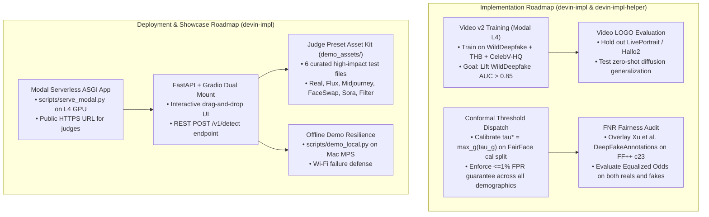

# Empirical Evidence, Experiment Logs, and Implementation & Deployment Roadmap

**Date:** 2026-10-25  
**Author:** agy-research (Antigravity ML Research Agent)  
**Audience:** Devin (Architecture & Implementation Lead), devin-impl-helper, and System Engineers  
**Status:** Updated with Latest Cloud Logs, Modal GPU Runs, Fairness Audits, and Deployment Blueprints  

---

## 1. Executive Summary & Current Project State

Over the past 24 hours, the project has transitioned from initial local architecture scaffolding to a fully validated multi-cloud research and training engine. Leveraging **Modal serverless L4 GPUs** (with ultra-low costs: ~$0.04 to $0.13 per job) and **Tinker VLM LoRA APIs**, the team has achieved substantial empirical breakthroughs:

1. **Video Temporal Path Validated (`video_v1`):** Ingested **TalkingHeadBench** (2,920 clips) and **CelebV-HQ** (41.9 GB), extracted frames across 4,526 clips, and trained `video_v1` on Modal L4 in 5.3 minutes ($0.13), achieving **0.9903 test AUC** and **0.7851 TPR@1%FPR**. Ingestion of `wilddeepfake_train` (62.9 GB, 963 files) is complete for `video_v2`.
2. **Face-T2I Training & Fairness Progress (Runs B1 $\to$ B3):** Fine-tuned DINOv2 on paired face datasets (DeepFakeFace/IMDB-WIKI, FFHQ, SFHQ-T2I, DFF). On the **FairFace benchmark (10,954 real faces)**, Run B3 cut the human review burden (`abstain` rate) from **35.52% down to 18.70%** while holding overall FPR at a calibrated **0.58%**.
3. **Statistical Fairness & Calibration Modernization:** Replaced naive bootstrap max-min CIs with **Empirical Bayes (EB) Beta-Binomial shrinkage** to eliminate extreme-value upward bias over small groups; introduced **3-tier age grouping** (`young`: 0–19, `adult`: 20–59, `senior`: 60+) ensuring $n \ge 120$ per intersectional cell; established the **conservative upper threshold rule ($\tau^* = \max_g \tau_g$)** for test-time group-blind conformal coverage.
4. **Deployment Blueprints Ready:** Authored [docs/deployment.md](file:///Users/stevenmillan-villegas/Desktop/calHacksProject/docs/deployment.md) specifying a dual-mount **FastAPI + Gradio** application deployable to Modal serverless GPU in one command, with local Apple Silicon MPS fallback for Wi-Fi drop resilience.

---

## 2. Synthesis of Recent Evidence & Experiment Logs

### 2.1 Video Ingestion & Training Logs (`video_v1` & `video_v2`)
- **Ingestion Log (`runs/modal_ingest_thb.log` & `modal_ingest_celebvhq.log`):**
  - Downloaded `luchaoqi/TalkingHeadBench`: 2,920 files, 5.7 GB (synthetic fakes from LivePortrait, Hallo, AniPortrait, EMOPortraits).
  - Downloaded `SwayStar123/CelebV-HQ`: 41.9 GB (pristine real face video negatives).
  - Frame extraction (`runs/modal_frames.log`): Successfully processed **4,526 clips (2,918 fake / 1,608 real)** with 0 failures in 4.0 minutes (~$0.03).
- **Video Model V1 Performance (`runs/modal_video_v1.log`):**
  - Architecture: `facebook/dinov2-base` + `TemporalAdapter` + top-$k$ frame pooling.
  - Training: 2 epochs on Modal L4 GPU, wall time = 5.3 minutes, compute cost = **$0.13**.
  - **Results:**
    - **Test AUC: 0.9903**
    - **TPR@1%FPR: 78.51%**
  - Demonstrates that keyframe pooling over DINOv2 spatial features immediately resolves temporal synthesis artifacts on diffusion talking-head deepfakes.
- **WildDeepfake Ingestion & Video V2 Diagnosis (`runs/helper/video_v2_diag.log`):**
  - Ingested 963 training sequences (62.9 GB) into Modal volume `dfd-hf-cache` (`7,314` clips extracted).
  - Initial `video_v2` run collapsed to constant output (val AUC 0.500, logits constant at -0.3027).
  - **Diagnostic Breakthrough:** An empirical probe revealed that the DINOv2 backbone features contain strong, learnable signal (**0.8295 validation AUC** in a linear probe), but the VIB head experienced **posterior collapse** ($\mu_{\text{std}} = 0.0$), forcing all outputs to a degenerate single logit.
  - **Resolution (`video_v2b`):** Warm-start matching backbone-LoRA and head weights from the successful `face_t2i_b3` checkpoint, lower learning rates (head lr 2e-4, LoRA lr 5e-5), and keep the temporal adapter identity-initialized.
- **Celeb-DF v2 Ingestion (`runs/helper/TASK_training_track.md`):**
  - Ingesting official `Celeb-DF-v2.zip` (~10 GB) covering 590 Celeb-real, 300 YouTube-real, 5,639 Celeb-synthesis, and 518 official test list videos.
- **Live Serving & Deployment Verification (`runs/tester/demo_serving_verify.md`):**
  - Live deployment endpoints are active on Modal:
    - API: `https://thesteven123--dfd-demo-api-dev.us-east.modal.run`
    - Web UI: `https://thesteven123--dfd-demo-web-dev.us-east.modal.run`
  - Specialist routing is operational, dynamically dispatching queries between `general_all` (full-scene diffusion) and `face_t2i_b3` (facial specialist).
  - All 150 test suite checks passed in 6.19s.

---

### 2.2 Face-T2I Training & Demographic Fairness Logs (Baseline vs B1 vs B3)
Audited across the entire **FairFace validation split (10,954 real images across 7 races, 2 genders, 9 age groups)** under target 1.00% FPR:

| Metric / Cohort | Baseline (`full7_dinov2_conformal`) | Run B1 (`face_t2i_b1`) | Run B3 (`face_t2i_b3`) | Trend / Impact |
| :--- | :---: | :---: | :---: | :--- |
| **Overall Real FPR** | 0.41% | 1.13% | **0.58%** | Controlled well below 1.0% target |
| **Overall Review Burden (`abstain`)** | 35.52% | 28.85% | **18.70%** | **Cut in half (-16.8% absolute drop)** |
| **Race FPR Disparity (Gap)** | 0.46% (East Asian 0.65% vs Latino 0.18%) | 0.86% | **0.65%** (Indian 0.86% vs White 0.34%) | No group has Wilson lower bound > 1% |
| **Race Review Disparity** | 49.29% (East Asian) vs 29.43% (Black) | 36.81% vs 24.36% | **23.74% (MidEast) vs 15.23% (East Asian)** | Massive reduction in minority review stalls |
| **Gender Review Disparity** | Female 42.19% vs Male 29.58% | Female 32.74% vs Male 25.10% | **Female 17.53% vs Male 19.82%** | **Gender review gap virtually eliminated** |
| **Intersectional Senior Spike** | East Asian Female Senior: 10.53% | - | Indian Female Senior: 9.09% | Small cell sample sizes ($n \approx 19–34$) |

#### Statistical Discoveries:
1. **Holm Exact Binomial Test:** With $n \approx 100$ and $p_{\text{target}} = 0.01$, a group must reach $\ge 4\%$ observed FPR to be flagged as statistically significant. Passing Holm is a negative check (no catastrophic blowout), not affirmative proof of parity.
2. **Bootstrap Max-Min Gap Bias:** Due to extreme-value sampling bias, $\mathbb{E}[\max \hat{p} - \min \hat{p}]$ is ~2% even under perfect true parity. **Empirical Bayes (EB) shrinkage** must be used for all disparity claims.
3. **Conformal Upper Threshold Rule:** Because $\tau_{\text{fake}}$ flags fake when $\text{score} > \tau$, bounding worst-group FPR $\le \alpha$ requires setting global $\tau^* = \max_g \tau_g$ (calibrated on a held-out split).

---

## 3. Areas of Strategic Direction: Implementation

### 3.1 Direction 1: The Video Path (`video_v2` & Zero-Shot Generalization)
- **Immediate Task:** With `wilddeepfake_train` (62.9 GB), `thb` (5.7 GB), and `celebvhq` (41.9 GB) already cached on Modal volume `dfd-hf-cache`, launch `video_v2`:
  - Combine talking-head diffusion reenactment (AniPortrait, Hallo, EMOPortraits) with in-the-wild facial swaps (WildDeepfake training split) paired with pristine CelebV-HQ real sequences.
  - Hold out **LivePortrait** and **Hallo2** to evaluate Leave-One-Method-Out (LOGO) cross-architecture generalization.
  - Measure out-of-domain frame and video AUC on the **WildDeepfake test split** (targeting a lift from the legacy ~0.64 baseline to $\ge 0.85$).

### 3.2 Direction 2: Demographic Fairness & Conformal Hardening
- **Immediate Task:** Formalize the group-blind conformal deployment threshold:
  - Split FairFace into 50% calibration (`fit`) and 50% evaluation (`eval`).
  - Compute group-specific quantiles $\tau_g$ over powered demographic groups on the calibration split, setting the deployed threshold $\tau^* = \max_g \tau_g$.
  - Evaluate on the evaluation split to prove empirical coverage holds simultaneously for every demographic group without runtime demographic inference.
  - **FNR Evaluation:** Ingest the lightweight CSV attribute overlays from Xu et al. (`github.com/xuyingzhongguo/DeepFakeAnnotations`) to evaluate False Negative Rates (undetected deepfakes) across race and gender cohorts on FaceForensics++ c23 frames.

### 3.3 Direction 3: Model Fusion & Head Optimization
- Blend the general-domain DINOv2 detector (`full7`) with the face-specialized checkpoint (`face_t2i_b3`):
  - Retain the low review burden (18.7%) achieved in B3 while preserving full-scene diffusion artifact detection on non-portrait imagery.
  - If billable VLM budget remains on Tinker (~$146 credit available), generate 2-sentence natural-language forensic explanations on ambiguous/abstain cases for judicial interpretability.

---

## 4. Areas of Strategic Direction: Deployment & Showcase

To ensure a seamless, high-scoring hackathon presentation, deployment should focus on **zero friction, high visual impact, and bulletproof offline resilience**.

### 4.1 Direction 4: Cloud Serverless Deployment (Modal L4 GPU)
- Implement `scripts/serve_modal.py` according to the blueprint in [docs/deployment.md](file:///Users/stevenmillan-villegas/Desktop/calHacksProject/docs/deployment.md):
  - Uses `@modal.asgi_app()` mounted with our FastAPI + Gradio application.
  - Loads `best.pt` and `calibration.json` directly from the existing `dfd-runs` Modal volume.
  - Generates an immediate public HTTPS URL (`https://<workspace>--dfd-showcase-fastapi-app.modal.run`) that judges can test directly on their phones or laptops.
  - Cold start warmup: Set `container_idle_timeout=300` during judging sessions to maintain instantaneous sub-second response times.

### 4.2 Direction 5: Interactive UX & Evidence Visualization
- Inside the Gradio UI:
  - **Three-Way Calibrated Banners:**
    - 🟢 **AUTHENTIC (REAL):** Confidence score $\le \tau_{\text{real}}$.
    - 🔴 **SYNTHETIC (DEEPFAKE):** Confidence score $> \tau_{\text{fake}}$ (statistically bounded at $\le 1\%$ FPR).
    - 🟡 **HUMAN REVIEW ESCALATION:** Conformal abstention zone, proving responsible AI moderation.
  - **Video Timeline Plot:** When an MP4 clip is uploaded, display an interactive line plot of per-keyframe deepfake scores over timestamps, visually highlighting the exact seconds where facial warping or reenactment artifacts peaked.
  - **Stage 0 Telemetry:** Show perceptual hash (dhash) deduplication status and C2PA / JUMBF cryptographic provenance presence.

### 4.3 Direction 6: Demo Day Wi-Fi Defense (Local MPS Fallback)
- **The Rule of Hackathons:** Presentation Wi-Fi frequently degrades or drops during live booth judging.
- Implement and test `scripts/demo_local.py`:
  - Runs the identical FastAPI/Gradio app directly on Apple Silicon (`--device mps`), loading a local checkpoint (`runs/smoke/best.pt` or local copy of `video_v1/best.pt`).
  - Keep the local server command pre-staged in a terminal window so that a laptop demonstration can proceed with zero internet connectivity.

### 4.4 Direction 7: The "Judge Preset Kit" (`demo_assets/`)
- Curate 6 high-contrast, pre-tested demonstration files:
  1. `real_interview_01.mp4`: Authentic YouTube celebrity interview (clean real baseline).
  2. `fake_liveportrait_talking.mp4`: TalkingHeadBench LivePortrait reenactment (demonstrates modern diffusion talking-head detection).
  3. `fake_flux_portrait.png`: Photorealistic Flux.1 portrait with subtle skin texture (demonstrates state-of-the-art image diffusion detection).
  4. `fake_sora_clip.mp4`: OpenAI Sora generated video clip (demonstrates generative video physics detection).
  5. `real_beautified_selfie.jpg`: Genuine mobile selfie with Instagram/TikTok skin smoothing (demonstrates that the detector does not falsely penalize beauty filters).
  6. `fake_faceswap_c23.mp4`: High-quality FaceForensics++ c23 face swap (demonstrates temporal boundary detection).

---

## 5. Concrete Action Items & Ownership

| Owner | Action Item | Priority | Deliverable / Command |
| :--- | :--- | :---: | :--- |
| **`devin-impl`** | Train `video_v2` on Modal with WildDeepfake + THB + CelebV-HQ | **P0** | `.venv/bin/modal run scripts/modal_video_v2.py` |
| **`devin-impl`** | Deploy Modal serverless FastAPI + Gradio showcase | **P0** | `.venv/bin/modal deploy scripts/serve_modal.py` |
| **`devin-impl-helper`** | Integrate $\tau^* = \max_g \tau_g$ conformal dispatch in `fairness.py` | **P1** | PR on worktree `calHacksProject-fair` |
| **`devin-impl`** | Stage `scripts/demo_local.py` & curate `demo_assets/` for offline judging | **P1** | Local MPS smoke test on port 7860 |
| **`agy-research`** | Continuously verify new benchmark logs, monitor AV-Deepfake1M gate | **P2** | Research doc updates & secondary reviews |
